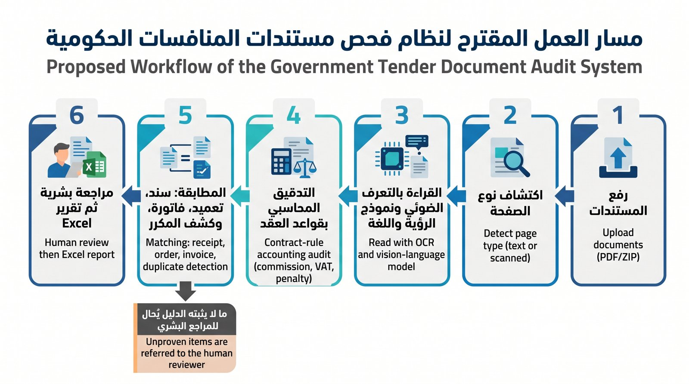
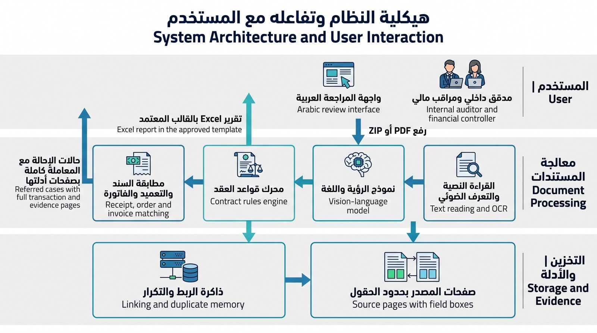
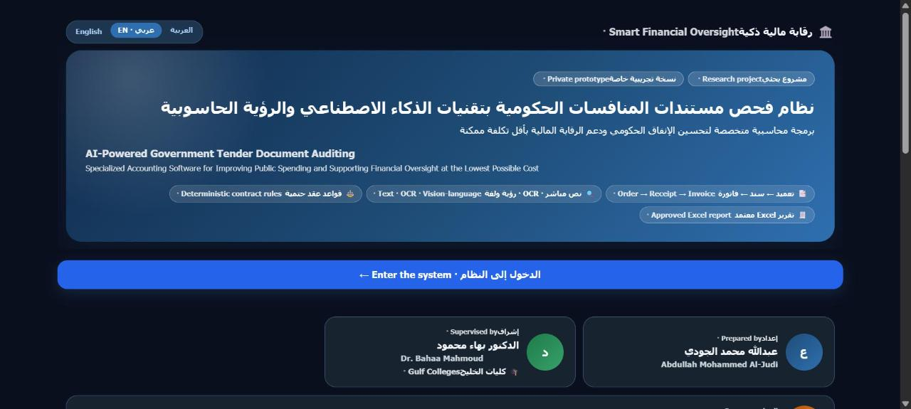

<div align="center">

# 🏛️ نظام فحص مستندات المنافسات الحكومية بالذكاء الاصطناعي
# AI Audit System for Government Tender Documents

**يقرأ ربطات الصرف كاملة، ويطابق التعميد وسند الاستلام والفاتورة، ويحسب العمولة والضريبة والغرامة من نص العقد، ويحيل ما لا يثبته الدليل إلى المدقق مع صفحاته.**

*Reads full payment bundles, matches purchase orders, receipts and invoices, applies the contract's commission, VAT and penalty rules, and refers anything the evidence cannot prove to a human auditor with its source pages.*


[🚀 التطبيق التجريبي · Live demo](https://huggingface.co/spaces/abade1990/audit-review-private) ·
[📦 البيانات الاصطناعية · Synthetic data](https://drive.google.com/drive/folders/1_QB4FgriP94bvWXmKVomWNuFOUSgzYQz) ·
[🧪 النتائج · Results](#-النتائج--results) ·
[⚙️ التشغيل · Run it](#️-التشغيل--getting-started)

</div>

---

<div dir="rtl">

## 📌 نبذة

قبل صرف مستحقات المورد في المنافسات الحكومية، يراجع المدقق ربطة قد تتجاوز مئات الصفحات: عقد، وأوامر تعميد، وسندات استلام، وفواتير. والفحص اليدوي يعتمد غالباً على العينة، فتفوته أخطاء صغيرة تتكرر في الواقع، مثل ضريبة محسوبة على صنف معفى، أو عمولة على غير أساسها، أو سند استلام مكرر.

هذا المشروع نموذج أولي يفحص **كل** السندات بدل العينة. يقرأ النظام المستندات (نصية أو ممسوحة)، ويستخرج قواعد الحساب من نص العقد، ويطابق المستندات ببعضها على مستوى البند، ثم يصدر تقرير Excel بالقالب المعتمد. وكل ما لا يستطيع إثباته يُحال إلى المدقق مع المعاملة كاملة وصفحاتها الأصلية، والقرار النهائي له.

> مشروع تخرج لنيل **الدبلوم العالي في الذكاء الاصطناعي** من **كليات الخليج**.

</div>

## 📌 Overview

Before a supplier is paid on a government tender, an auditor has to review a bundle that can run to hundreds of pages. Manual review usually relies on sampling, which misses small but recurring errors such as VAT charged on an exempt item, commission on the wrong base, or a duplicated goods receipt.

This prototype checks **every** receipt instead of a sample. It reads text or scanned PDFs, extracts the calculation rules from the contract itself, matches documents line by line, and writes the report in the approved Excel template. Anything it cannot prove goes to a human reviewer with the full transaction and its source pages.

---

<div dir="rtl">

## 🧠 الفكرة الأساسية: النموذج يقرأ، والمحرك يحكم

</div>

## 🧠 Core idea: the model reads, the engine decides

| | النموذج اللغوي البصري · Vision-language model | محرك القواعد · Rules engine |
|---|---|---|
| **الدور · Role** | ينسخ القيم كما هي مطبوعة · copies printed values | يحسب ويطابق ويحكم · computes, matches, decides |
| **الحساب · Math** | ممنوع · never | حساب عشري دقيق `Decimal` |
| **إذا لم يرَ الحقل · Missing field** | يعيده فارغاً ولا يخمن · returns `null` | يحيل للمراجعة · refers to reviewer |

أخطاء القراءة تُكتشف في بوابة تحقق حتمية أو في المطابقة بين المستندات، فلا تصل إلى الحكم المحاسبي.
*Reading errors are caught by a deterministic gate or by cross-document matching, so they never reach the accounting verdict.*

---

## 🔄 مسار العمل · Workflow



## 🏗️ الهيكلية · Architecture



---

## ✨ المزايا · Features

| الميزة | Feature |
|---|---|
| 📄 قراءة النص المباشر، والتعرف الضوئي، ونموذج رؤية ولغة للصفحات الممسوحة | Direct text, OCR and a vision-language model for scanned pages |
| 📜 استخراج قاعدة الضريبة والعمولة والغرامة من نص كل عقد مع دليل الصفحة | Tax, commission and penalty rules read from each contract, with page evidence |
| 🧾 مطابقة على مستوى البند، ودعم الفاتورة المشتركة بين عدة سندات وتعاميد | Line-level matching, including one invoice shared by several receipts and orders |
| 🔁 كشف السند المكرر داخل الربطة الواحدة وعبر ربطات المنافسة | Duplicate receipts detected within a bundle and across bundles |
| 🧪 بوابة تحقق حتمية تقبل القراءة أو تحيلها مع السبب | Deterministic gate that accepts a reading or refers it with a reason |
| 🧭 فحص الدفعة دون عقد بتقنية «السند المرجع» | Contract-free batch check using a *reference receipt* |
| 👤 مراجعة بقرارين («سليم» أو «فيه مشكلة») مع ملاحظة واسم المراجع إلزاميين | Two-decision review with a mandatory note and reviewer name |
| 📊 تقارير Excel بقالبين مقفلين لا تُضاف لهما أعمدة ولا تُحذف | Excel reports in two locked templates |
| 🔄 أداة مستقلة لتصحيح اتجاه الصفحات دون فقد في جودة الصورة | Separate lossless page-orientation tool |
| ⏱️ شريط تقدم حقيقي بعدد الصفحات المقروءة، وإلغاء فوري للفحص | Real page-based progress bar and instant cancel |



---

## ⚙️ أنماط التشغيل · Modes

| | فحص منافسة · Competition | فحص دفعة · Batch | دفعة دون عقد · Batch, no contract |
|---|---|---|---|
| **المدخلات · Input** | العقد + ربطات المنافسة | العقد + ربطة واحدة | ربطة واحدة |
| **القواعد · Rules** | من نص العقد | من نص العقد | من السند المرجع |
| **السند المكرر · Duplicates** | داخل الربطة وعبر الربطات | داخل الربطة | داخل الربطة |
| **السند المخالف · Deviation** | «غير سليم» مع السبب | «غير سليم» مع السبب | يُحال للمراجعة |
| **التقرير · Report** | قالب المنافسة | قالب الدفعة | قالب الدفعة (مسودة) |

---

## 🧪 النتائج · Results

القياس كله على **بيانات اصطناعية** صممها الباحث، وأُعيدت الاختبارات على النسخة النهائية من الكود في 17 أكتوبر 2026.
*All measurements use **synthetic** data designed by the researcher; every test was re-run on the final code on 17 Oct 2026.*

| الاختبار · Test | النتيجة · Result |
|---|---|
| مطابقة 7 منافسات نصية مع تقاريرها · 7 text-layer tenders vs. reports | **7,249 / 7,249** سنداً دون أي فرق، في ~26 دقيقة على حاسب محمول |
| مجموعة الأخطاء المزروعة · Planted-error set (44 receipts) | **10 / 10** أخطاء مكتشفة بأسبابها، و**0** إنذار كاذب على 34 سنداً سليماً |
| ربطات ممسوحة اصطناعياً (~216 نقطة) · Synthetic scans | **57 / 61** مقبولة صحيحة، و**0** خطأ ممرَّر، و4 إحالات احتياطية |
| السندات المكررة · Duplicate receipts | **3 / 3** حالات قابلة للكشف، مع صفحتي النسختين |
| فحص الدفعة دون عقد · No-contract batch | **86** سنداً دون فروق، وكشف المخالفتين المحقونتين |
| تصحيح الاتجاه · Orientation tool | **12 / 12** صفحة مُدارة صُححت |
| قالب جديد لم يره النظام (49 صفحة) · Unseen template | **0** قبول آلي، و**15 / 15** سنداً محالة؛ الأمان قبل الأتمتة |

**ما تعلمناه · Lessons**
- هندسة الأمر والمعالجة المسبقة رفعتا دقة القراءة أكثر من الضبط الدقيق (LoRA).
  *Prompt design and preprocessing helped more than LoRA fine-tuning.*
- اتفاق قراءتين من النموذج نفسه لا يكفي، لأن خطأه منهجي.
  *Two reads from the same model agreeing is not evidence: its errors are systematic.*
- انخفاض دقة المسح أو تغير القالب يرفع الإحالة، ولا يرفع الخطأ الممرَّر.
  *Low scan quality or a new template raises referrals, not missed errors.*

---

## 🛠️ التقنيات · Tech stack

| المجال · Area | الأدوات · Tools |
|---|---|
| قراءة PDF · PDF | `pdfplumber`, `pypdfium2` |
| التعرف الضوئي · OCR | Tesseract (Arabic + Latin), Tesseract OSD |
| نموذج الرؤية واللغة · VLM | Qwen3.5-9B, served by vLLM |
| الضبط الدقيق · Fine-tuning | LoRA (r=32, α=64) with PEFT and Transformers |
| محرك القواعد · Rules | Python `Decimal` |
| الواجهة · UI | Gradio (Arabic RTL) |
| التقارير · Reports | `openpyxl` with a built-in formula evaluator |
| البنية · Infra | Hugging Face Spaces, RunPod GPU with a cost guard |

---

## 📁 هيكل المستودع · Repository layout

```
ocr_audit_v2/
├── app.py, landing.py          واجهة المراجعة وصفحة التعريف · review UI and landing page
├── job_pipeline.py, job_runner.py  إدارة المهام في الخلفية · background jobs
├── extract.py, pdfx.py         قراءة النص المباشر · text-layer extraction
├── scan_reader.py, vlm_reader.py   التعرف الضوئي ونموذج الرؤية · OCR and VLM reading
├── engine.py                   محرك قواعد العقد · contract rules engine
├── invoice_match.py            مطابقة الفاتورة المشتركة · shared-invoice matching
├── report_writer.py, competition_writer.py  تقارير Excel · Excel writers
├── report_template.py, xl_calc.py  قفل القوالب وحساب الصيغ · template lock, formula check
├── orient_tool.py              أداة تصحيح الاتجاه · orientation tool
├── templates/                  قالبا التقارير · report templates
├── vlm/                        البوابة، والبيانات الاصطناعية، وضبط LoRA · gate, synthetic scans, LoRA
└── test_*.py                   اختبارات الانحدار · regression tests
```

---

## ⚙️ التشغيل · Getting started

```bash
pip install -r requirements.txt
cd ocr_audit_v2
python app.py            # http://127.0.0.1:7860
```

- للصفحات الممسوحة ثبّت **Tesseract** مع اللغة العربية. *For scanned pages install Tesseract with Arabic.*
- لنموذج الرؤية شغّل خادم vLLM ثم عرّف المتغيرين: *For the VLM, start a vLLM server and set:*
  `VLM_URL=http://<host>:8000/v1` و `VLM_MODEL=Qwen/Qwen3.5-9B`
- أداة تصحيح الاتجاه وحدها: *Orientation tool alone:* `python orient_tool.py --ui`
- الاختبارات: *Tests:* `python test_engine.py` (وبقية `test_*.py`)

---

<div dir="rtl">

## ⚠️ حدود المشروع

- نموذج بحثي، ومخرجاته مسودات للمراجعة لا قرارات رقابية.
- القياس على بيانات اصطناعية، والخطوة التالية القياس على وثائق ميدانية موسومة.
- عبارة «مقفل حسابياً» تعني تطابق المستندات وصحة الحساب، ولا تعني أن المبلغ صُرف.
- يُوصى بتشغيل النظام داخل الجهة، حتى لا تخرج المستندات إلى أي خدمة خارجية.

</div>

## ⚠️ Limitations

Research prototype: outputs are review drafts, not audit decisions. Results are on synthetic data. On-premises deployment is recommended so documents never leave the organization.

---

<div align="center">

**إعداد · Author:** عبدالله محمد الجودي · Abdullah Mohammed Al-Judi
**إشراف · Supervisor:** الدكتور بهاء الدين حمودة · Dr. Bahaa Eldin Hamouda
**كليات الخليج · Gulf Colleges** · الدبلوم العالي في الذكاء الاصطناعي · Higher Diploma in AI · 2026

</div>
